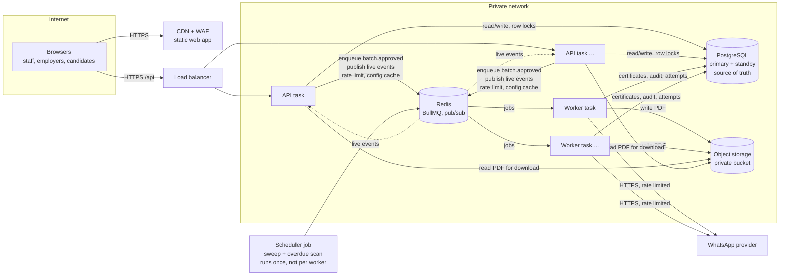

# Deployment plan

A production plan for the load in the brief. Deployment itself is not part of this submission; this
document says how I would run it, and is explicit about what the code already does versus what the
plan adds. Cost and sizing figures are **estimates** (see "How sure am I?" at the end).

## 1. The load

| Quantity | Figure (from the brief) | What it means for the system |
|---|---|---|
| Registered users | 100,000 | A users table of that size is tiny for Postgres |
| Daily active users | ~10,000 | Say 30 requests each = ~300k requests a day = **~3.5 requests/s on average**, ~35-50/s in bursts |
| Results-day peak | ~500 batches approved in an hour = **30,000 certificates** | 30,000 PDFs and 30,000 WhatsApp messages in an hour = **8.3 per second sustained** |
| Public verification | thousands a day, in bursts | One indexed lookup each: trivial, but it is public, so it is rate limited |
| Live connections | up to a couple of thousand staff browsers | One long-lived (SSE) connection each: cheap for Node, but it affects how we scale the API |

## 2. Architecture

**How events flow (this is what the code does today):**
1. API commits a decision + audit row in one Postgres transaction, then answers the user.
2. API adds a `batch.approved` job to the `events` queue (BullMQ on Redis).
3. A worker consumes it and adds one `issue` job per candidate to the `issuance` queue
   (job id = candidate id, so adding twice is harmless).
4. Any worker takes an `issue` job: create certificate, render PDF, send WhatsApp, record result.
5. Every state change publishes a tiny "something changed" message on Redis pub/sub; every API instance
   forwards it to its connected browsers over SSE.
6. A repeating **sweep** job re-offers any batch that is approved but not finished (recovers from lost events).
7. A repeating **overdue scan** flags batches that have waited past their step's SLA.

## 3. Where each component runs, and why

I would use AWS in Mumbai (`ap-south-1`) because the users and the WhatsApp traffic are in India and
data stays in-country. The same shape works on any cloud.

| Component | Hosted on | Why |
|---|---|---|
| Web app (static) | S3 + CloudFront | Static files; the CDN absorbs traffic spikes for free and keeps load off the API |
| API (Express) | ECS Fargate, 2+ tasks behind an Application Load Balancer | Stateless, so it scales by adding tasks. No servers to patch. The ALB must allow long idle timeouts for SSE |
| Worker (same image) | ECS Fargate service, scaled on queue depth | Scales independently of the API; this is the part that grows on results day |
| Scheduler | One-off ECS scheduled task, or the existing BullMQ repeatable jobs (already deduplicated across workers) | Exactly one sweep / scan at a time |
| PostgreSQL | RDS for PostgreSQL, Multi-AZ, automated backups + point-in-time recovery | It is the source of truth. Managed failover and backups are worth the money here |
| Redis | ElastiCache for Redis (primary + replica, Multi-AZ), `maxmemory-policy noeviction` (BullMQ requires it) | Queues, pub/sub, cache, rate limits. **We do not depend on Redis for durability**: Postgres is the truth and the sweep rebuilds the queue. (A durable option such as MemoryDB exists if we ever wanted that) |
| Certificate PDFs | S3, private bucket | Cheap, durable, and shared by every task (a local volume would not work across hosts) |
| WhatsApp | A WhatsApp Business API provider | The real thing the fake stands in for |
| Secrets | Secrets Manager (JWT secret, DB password, provider token) | Never in the image or the repo |
| Logs / metrics / alerts | CloudWatch (or Grafana stack) | See section 7 |
| Sign-in | An OIDC identity provider (e.g. Cognito) replacing the demo "switch user" | Real authentication; the permission model in the code is already real |

**Before going live:** `DEMO_MODE=false`; close the Postgres and Redis ports (the compose file exposes
them for convenience); database and Redis in private subnets with security groups that only allow the
API and worker; TLS everywhere; run `prisma migrate deploy` as a one-off task before each rollout
(rather than at container start), with backward-compatible migrations so old and new versions can run
side by side during a rolling deploy.

## 4. Scaling

| Part | Scales how | What limits it |
|---|---|---|
| Web | CDN | nothing relevant |
| API | **Horizontally**: add tasks (it keeps no state in memory) | Postgres connections; open SSE connections per task (a few thousand each) |
| Worker | **Horizontally**: add tasks; BullMQ gives each job to exactly one worker, and a dead worker's job is re-run | The WhatsApp provider, then Postgres connections |
| Postgres | Vertically (bigger instance), plus a read replica for dashboards/verify if ever needed | Write rate, connections. Row locks are per batch, so unrelated batches never block each other |
| Redis | Vertically; Redis is single-threaded, but this load is a few hundred operations per second | Memory (job data); `noeviction` |

### What limits throughput at the peak
1. **The WhatsApp provider is the real ceiling**, not our code. Providers limit messages per second
   *and* limit how many distinct people a number may message per day (tiered, and a new number starts
   low and has to be ramped up). The worker has a built-in cap (`WHATSAPP_RATE_PER_SEC`) so we never
   exceed the provider's limit. **The tier of the sending number must be sorted out well before results day.**
2. **Database connections**: each worker runs several jobs at once and each uses a connection. Put
   RDS Proxy (or PgBouncer) in front and cap each task's pool.
3. **Not PDF generation**: I measured it. Rendering one certificate (with its QR code) takes **about 6 ms
   on one Apple M1 core (~165 per second)**. Even at 3x slower on a cloud vCPU, 30,000 PDFs is a few CPU-minutes.
4. **Not the queue or the database writes**: about 5 rows per certificate means ~150,000 rows an hour
   (~40 per second), which is easy for Postgres.

### The arithmetic
Throughput of the issuing path is roughly `workers × concurrency ÷ time per job`. A job is dominated by
the provider call, say 0.5 s (an assumption; measure with the real provider). With the fake provider
failing ~30% of calls, retries add ~40% more calls.

| Workers × concurrency | Parallel jobs | Approx. certificates/s | 30,000 certificates take |
|---|---|---|---|
| 1 × 5 | 5 | ~7 | about 70 min (not enough) |
| 4 × 5 | 20 | ~28 | about 18 min |
| 8 × 5 | 40 | ~57 | about 9 min (then limited by the provider cap) |

So: run **4 workers normally and autoscale to ~8-10 on results day**, with the provider rate cap set to
what the provider allows.

### How the backlog is cleared
- Approvals are fast (an API write + one queued event), so the queue absorbs the whole burst instantly;
  users are never kept waiting.
- Workers are autoscaled on **queue depth and oldest-job age** (a CloudWatch metric published from
  BullMQ's job counts; not built yet). Scale out when depth is high, scale in when it drains.
- The rate cap turns "too fast" into "a little slower" rather than "provider blocks us".
- Pending work is always visible: batch page shows "n of m delivered", and a batch is `COMPLETED` only
  when nothing is pending. Failed deliveries are listed for the state office to retry.

## 5. Failure handling

| Failure | What happens (as built) | What I would add in production |
|---|---|---|
| **A worker crashes** (killed, OOM, node lost) | Its in-flight job is detected as stalled and given to another worker. Every step is idempotent: one certificate per candidate (unique key), PDF written only if missing, and the WhatsApp message carries an idempotency key, so a job that died half-way never produces a second certificate or message. **Tested**: stopping a worker mid-batch and starting a new one finishes with exactly one message per phone | Autoscaling replaces the task; alarm if worker count is 0 |
| **Redis restarts / loses data** | Postgres is the source of truth. The 30-second **sweep** re-offers every approved/issuing batch from the database, so lost jobs reappear (job ids make re-adding safe). **Tested**: batch approved with no event queued still issues. While Redis is down: API reads config from Postgres (slower, correct); the rate limiter lets requests through; live updates pause and browsers re-fetch on reconnect; *new approvals still succeed*, the event is queued later by the sweep | Redis in Multi-AZ with automatic failover; alarm on memory and on connection errors |
| **WhatsApp outage** | Jobs retry with exponential backoff (8 attempts by default); after that the certificate is marked `FAILED`, the batch still completes, and the state office sees it and can retry (**tested**). Nothing is lost and no duplicates are made | A **circuit breaker** (stop calling a provider that is clearly down, pause the queue); a much longer retry window (hours) set by environment variable; alert when the provider error rate is high; optional second provider or SMS fallback |
| **Slow database** | Requests are wrapped in transactions that hold row locks only briefly, and each batch is locked separately. `/health` reports the database, so the load balancer pulls unhealthy API tasks | Statement and lock timeouts, connection pool limits and RDS Proxy (so a slow DB cannot exhaust connections), worker concurrency backpressure, a read replica for read-heavy screens, alarms on CPU, connections and replica lag |
| **API task dies** | Stateless: the load balancer sends traffic to the others; browsers reconnect their live stream automatically | Rolling deploys, min 2 tasks across 2 zones |
| **A bad deploy / bad migration** | Migrations are plain SQL files, reviewed in git | Backward-compatible (expand/contract) migrations, automatic rollback on failed health checks |

Data safety: Postgres automated backups with point-in-time recovery (14 days) plus daily snapshots kept
for 35 days; the audit log is append-only at the database level (a trigger refuses edits and deletes).

## 6. Certificate file storage and access control

- **Where:** a private S3 bucket (Block Public Access on, default encryption with a KMS key, versioning on).
  Object key = `certs/<certificate id>.pdf`. Nothing is ever served from a public URL.
- **Who can write:** only the worker's IAM role. **Who can read:** only the API's IAM role. Least privilege.
- **How a candidate gets their file:** the WhatsApp message contains a link to **our API** that carries an
  HMAC signature over the certificate id. The API checks the signature, checks the certificate is not
  cancelled (cancelled returns `410 Gone`), then either streams the file or redirects to a **short-lived
  (about 60 s) presigned S3 URL**. A guessed or altered link gets a plain `404`. (Today the code streams the
  file from disk; the storage access is isolated in `backend/src/pdf.ts`, so swapping in S3 is a change in one file.)
- **Verify never serves the file.** The public page shows only status, number, masked name, course, centre
  and date.
- **It can be rebuilt:** the PDF is derived from database rows and is regenerated if the file is missing, so
  losing the bucket is recoverable. **Retention:** certificates must stay verifiable for years, so no
  expiry; move objects to infrequent-access storage after a year.

## 7. Monitoring and alerting

Logs are structured JSON, and every line carries a request id that is also stored in the audit log and
follows a batch into the worker, so one story can be traced end to end. Production adds metrics:

| Signal | Alert when | Why it matters |
|---|---|---|
| Queue **oldest job age** (issuance) | > 10 min for 5 min | Certificates are late; add workers or check the provider |
| Failed jobs / `DELIVERY_FAILED` count | > 0 and rising | Provider trouble or bad numbers |
| WhatsApp error rate | > 20% for 5 min | Provider outage: trip the circuit breaker |
| **Overdue batches** (the brief's biggest complaint) | any batch overdue > 1 h | A human is slow; escalate beyond the in-app Stuck tab (email/Slack to the state office) |
| API 5xx rate and p95 latency | 5xx > 1%, p95 > 1 s | User-facing health |
| Verify 429 rate | sudden spike | Someone is scraping or guessing codes |
| Postgres CPU, connections, free storage, replica lag | CPU > 70%, connections > 80%, storage < 20% | Capacity |
| Redis memory, evictions, connection errors | memory > 75%, any eviction | BullMQ needs `noeviction`; evictions would lose jobs |
| Worker count | 0 | Nothing is processing |
| Health-check failures | any for 2 min | A task is unhealthy |

Needs building: a `/metrics` endpoint (queue depth/age, certificates by status, overdue count) and the
CloudWatch/Prometheus wiring. Today you can see the same numbers in the database and in `docker compose logs`.

## 8. Rough monthly cost, and the trade-offs

Estimates for `ap-south-1`, normal month (the results-day burst adds a few dollars of worker time):

| Item | Approx. USD / month |
|---|---|
| RDS PostgreSQL, Multi-AZ, ~100 GB, backups | 200-270 |
| ElastiCache Redis, primary + replica (small nodes) | 50-70 |
| API: 2 Fargate tasks (0.5 vCPU / 1 GB) | 25-40 |
| Workers: 2 baseline Fargate tasks (1 vCPU / 2 GB), burst on results day | 70-100 |
| Load balancer | 20-30 |
| NAT gateway + data transfer | 40-60 |
| S3 + CloudFront (PDFs are a few KB each; negligible) | 5-15 |
| Logs, metrics, alarms | 30-50 |
| WAF, Secrets Manager, KMS, DNS | 20-40 |
| **Total (before WhatsApp fees)** | **about 450-650** |

**WhatsApp message fees are separate** and depend on the provider's price list; this is likely a
significant line and I have not estimated it.

| Choice | Cheaper alternative | Trade-off I made |
|---|---|---|
| Multi-AZ database | Single instance, about half the cost | A zone failure means downtime and restoring from backup. For a system whose product is *trusted records*, I would pay for Multi-AZ |
| Managed Redis | Redis in a container | Saves ~$50 but adds a thing to patch and no failover. The sweep makes Redis loss survivable, so this is the first place to cut |
| Fargate | One EC2 instance running this repo's `docker compose` | About $60-100 a month all-in, but no high availability and manual scaling; fine for a pilot, not for results day |
| Always-on workers | Scale workers to near zero between results days | Saves ~$50; costs a cold start when a batch arrives |

## How sure am I?
- **Measured:** PDF generation speed (one run on a laptop).
- **Reasoned, not measured:** everything about throughput, the provider's latency and limits, connection
  counts and costs. The cost table is my estimate of current AWS prices and should be checked with the
  provider's calculator.
- **Not done:** a load test. Before results day I would run one against the real provider's sandbox with
  30,000 jobs and watch queue age, DB connections and provider errors.
